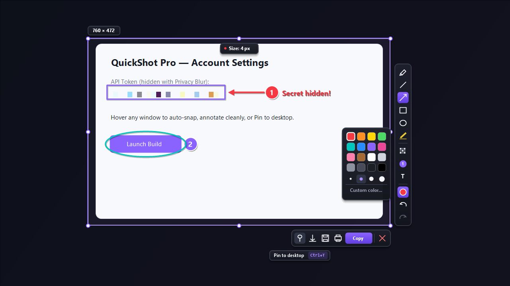
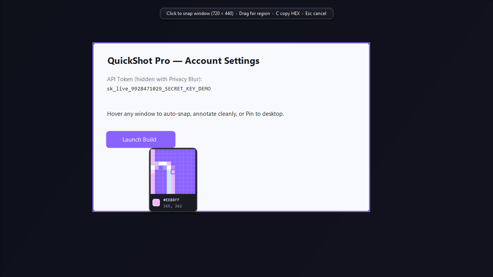
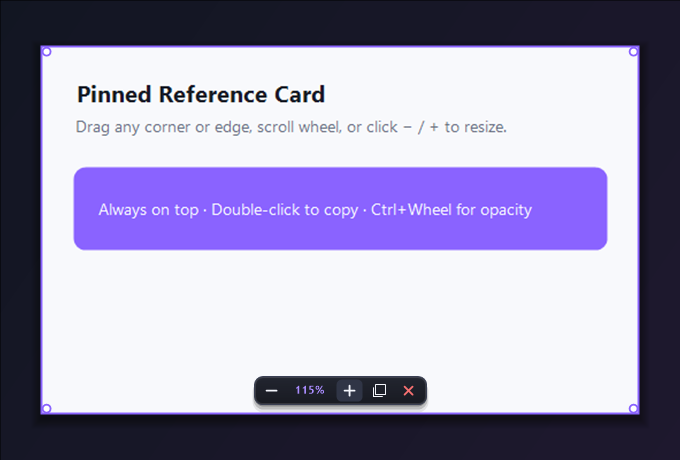
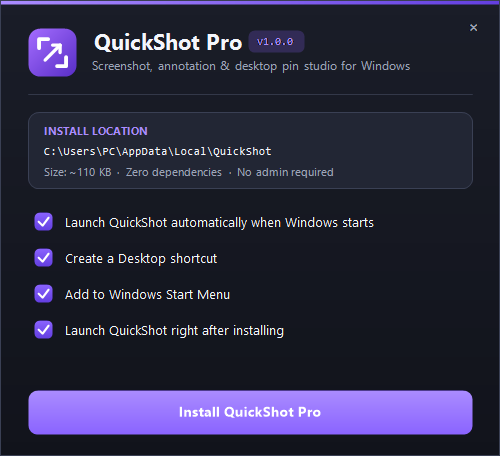

# QuickShot Pro

A fast, lightweight, zero-dependency screenshot, annotation & desktop pin studio for Windows — built in pure C# (`~96 KB` portable app, `~153 KB` one-click installer).

[](https://github.com/Ahmad-22dev/QuickShot/releases/latest)
[](https://github.com/Ahmad-22dev/QuickShot/releases/latest)
[](LICENSE)

### Download

- **[Download QuickShot-Setup.exe (Installer — Recommended)](https://github.com/Ahmad-22dev/QuickShot/releases/latest/download/QuickShot-Setup.exe)** — one-click dark-glass setup, no admin prompt, optional Windows startup & shortcuts, clean uninstall via Windows Settings → Installed Apps.
- **[Download QuickShot.exe (Portable)](https://github.com/Ahmad-22dev/QuickShot/releases/latest/download/QuickShot.exe)** — run directly from any folder with zero installation.

---

## Screenshots

| Annotation Studio | Smart Window Auto-Snap & Pixel Loupe |
| :---: | :---: |
|  |  |

| Interactive Resizable Pin Mode | One-Click Dark-Glass Installer |
| :---: | :---: |
|  |  |

---

## Features

- **Smart Window Auto-Snap** — Hover any open desktop window before dragging to highlight it with a violet frame, then single-click to snap your capture cleanly.
- **11×11 Pixel Magnifier & HEX Picker** — Zoomed pixel loupe with live `#RRGGBB` and `(x, y)` readout; press **`C`** to copy the HEX color instantly.
- **Dark-Glass Annotation Studio** — Smooth Pen (`P`), Line (`L`), Pro Arrow (`A`), Rectangle (`R`), Ellipse (`E`), Highlighter (`H`), mosaic **Privacy Blur** (`B`), auto-incrementing **Numbered Steps** (`N`), and **Text** (`T`) with `Ctrl+Z` / `Ctrl+Y` Undo & Redo.
- **Interactive Resizable Desktop Pins (`Ctrl+T`)** — Float any screenshot always-on-top over your workspace:
  - **Resize bigger or smaller:** Drag any corner or edge, scroll the mouse wheel, press **`+` / `-` / `0`**, or use the floating hover pill (`−`, `100%`, `+`, `Copy`, `×`).
  - **Opacity:** Hold `Ctrl` + Mouse Wheel (`25%`–`100%`).
  - **Quick copy:** Double-click the pinned shot or press `Ctrl+C`.
- **Delayed Capture (3 s / 5 s)** — Floating on-screen countdown for capturing tooltips, hover states, and dropdown menus.
- **Multi-Monitor & Per-Monitor DPI Aware** — Razor-sharp across mixed-DPI displays.

---

## Keyboard Shortcuts

| Shortcut | Action |
|---|---|
| `PrtSc` | Capture region or auto-snap window |
| `Shift + PrtSc` | Instantly save full screen to `Pictures\QuickShot` |
| `C` (before dragging) | Copy `#RRGGBB` HEX color under cursor |
| `P / L / A / R / E` | Pen, Line, Arrow, Rectangle, Ellipse (`Shift` snaps) |
| `H / B / N / T` | Highlighter, Privacy Blur, Numbered Steps, Text |
| `Mouse Wheel` | Adjust brush / blur / text size live |
| `Ctrl+Z` / `Ctrl+Y` | Undo / Redo annotation |
| `Ctrl+T` | Pin screenshot floating on desktop |
| `Pin: Drag / Wheel / + - 0` | Resize pinned screenshot bigger or smaller |
| `Ctrl+C` / `Enter` | Copy to clipboard (or double-click selection) |
| `Ctrl+Shift+S` | Quick Save PNG directly to `Pictures\QuickShot` |
| `Ctrl+S` / `Ctrl+P` | Save As… / Print |
| `Esc` / `Right-Click` | Reset selection or close overlay |

---

## Building from Source

Requires only Windows' built-in `.NET Framework 4` C# compiler (`csc.exe`) — zero SDKs or NuGet packages:

```bat
build.bat
```

Outputs both `QuickShot.exe` and the self-contained installer `QuickShot-Setup.exe`.

## License

[MIT](LICENSE)
